# Context {data-state="no-number" data-visibility="uncounted"}

## Searching sequences at scale {.smaller}

- A **k-mer** is a word of length $k$ taken from a sequence
- A **Bloom filter** per sample records which k-mers it contains
  - [compact, no false negatives]{.green}, but [false positives possible]{.red}
- A **query** reports the fraction of its k-mers found per sample
- **kmindex** [@lemane2024kmindex] builds and queries such indexes,
  on top of **kmtricks** [@lemane2022]
- Used to index [~50 petabases]{.green} of SRA data (Logan-Search) [@logan2024]

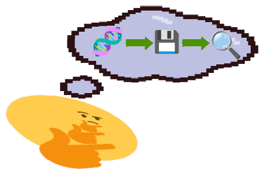{.nostretch fig-align="center" width="400px"}

::: notes
1 min. Set the vocabulary: k-mer, Bloom filter, sample, query score.
:::

## 3-mer example

::: {.r-stack}
$k = 3$

{.fragment .fade-out fragment-index=1 width="1000px"}

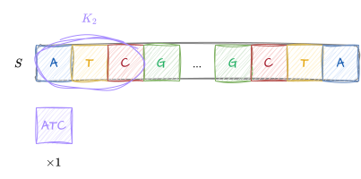{.fragment .fade-in-then-out fragment-index=1 width="1000px"}

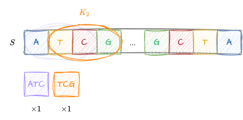{.fragment .fade-in fragment-index=2 width="1000px"}
:::

. . .

:::  {style="width: fit-content; margin: 0 auto; font-size: 0.7em;"}
➡ A sequence of length $L$ contains $(L - k + 1)$ k-mers.
:::

## Counting k-mers {.smaller}

{.nostretch fig-align="center" width="600px" style="aspect-ratio: 403/47; object-fit: cover; object-position: 0 30.7%;"}

| Position | 3-mer | Reverse complement | Canonical | Occurrence |
|---|---|---|---|---|
| 1 | ATC | GAT | [ATC]{style="background-color: #f4d4f4;"} | 1 |
| 2 | TCA | TGA | [TCA]{style="background-color: #d4f4d4;"} | 1 |
| 3 | CAA | TTG | CAA | 1 |
| 4 | AAT | ATT | AAT | 1 |
| 5 | ATG | CAT | ATG | 1 |
| 6 | TGA | TCA | [TCA]{style="background-color: #d4f4d4;"} | 2 |
| 7 | GAT | ATC | [ATC]{style="background-color: #f4d4f4;"} | 2 |

. . .

:::  {style="width: fit-content; margin: 40px auto;"}
➡ The total number of occurrences of a k-mer is called its **abundance**.
:::


## Presence/absence matrix

::: {.r-stack}
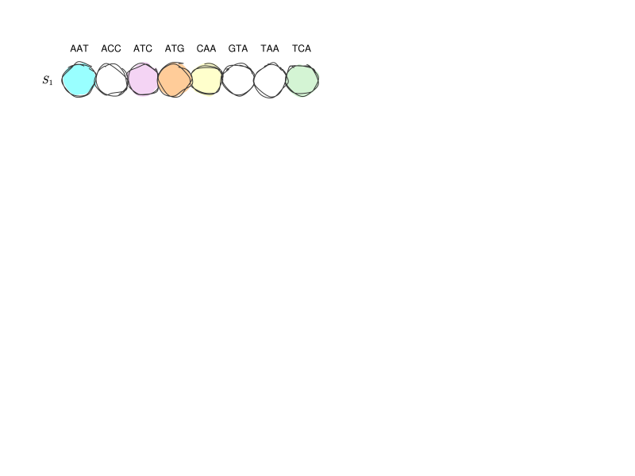{.fragment .fade-out fragment-index=1 width="1000px"}

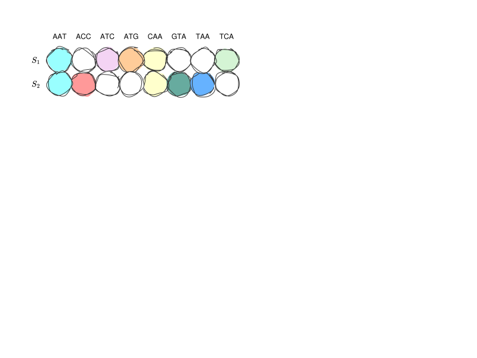{.fragment .fade-in-then-out fragment-index=1 width="1000px"}

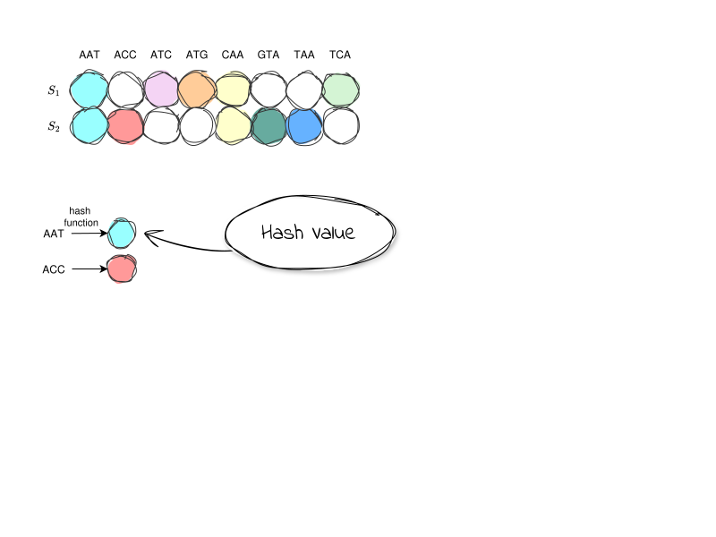{.fragment .fade-in-then-out fragment-index=2 width="1000px"}

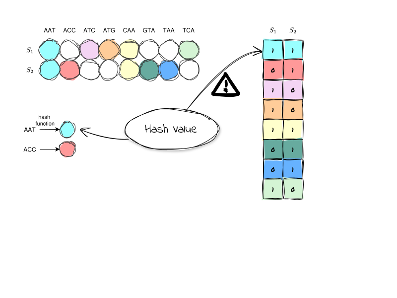{.fragment .fade-in fragment-index=3 width="1000px"}

:::

## Bloom Filter matrix {.smaller}

:::: {.columns}
::: {.column width="80%"}
::: {.incremental}
- Bloom filter: a **probabilistic** data structure
- Let $p$ be the false positive rate
- Storage: $-1/\ln(1-p)$ bits per k-mer [@broder2004]
  - ~$1/p$ bits per k-mer for small $p$ 
  - ~10 bits at $10\%$ ; ~4 bits at $25\%$
- Expectation:
user asks «Is k-mer `XXX` in sample $S_1$ ?» and wants [yes]{.green} or [no]{.red} answer
- Reality:
:::

::: {.r-stack style="margin-top: -60px;"}
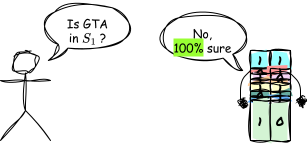{.fragment .current-visible width="500px"}

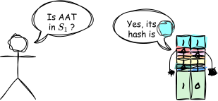{.fragment width="500px"}
:::
:::

::: {.column width="20%"}
{.nostretch fig-align="center" height="480px"}
:::
::::

## Bits per s-mer


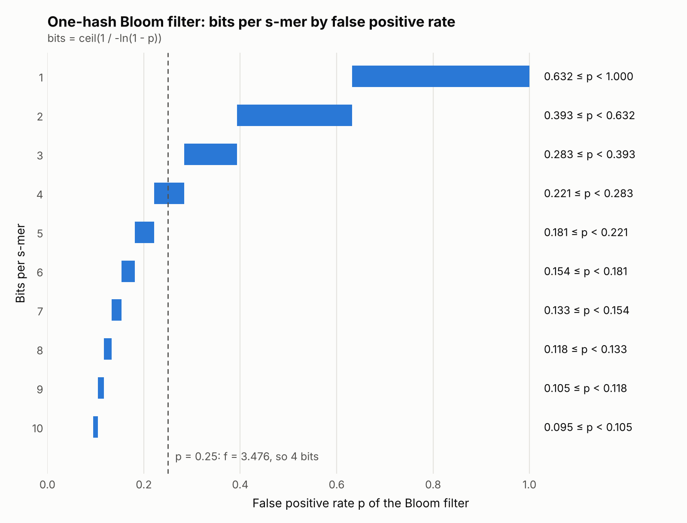{.nostretch fig-align="center" height="500px"}

. . .

Thanks to claude...

## Precision vs Cost {.smaller}

:::: {.columns}
::: {.column width="33%"}
{height="350px"}
:::

::: {.column width="33%"}
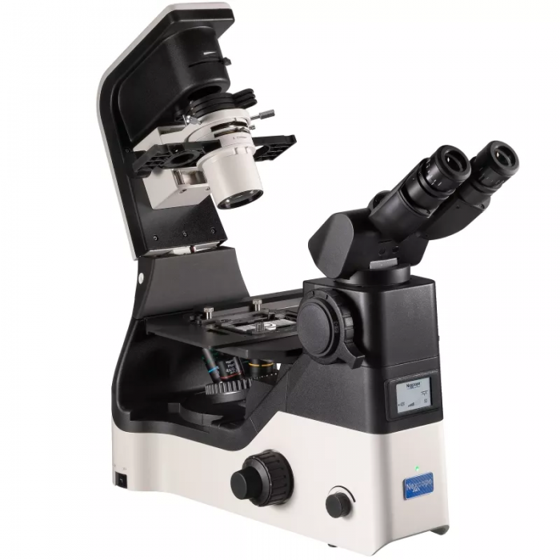{height="350px"}
:::

::: {.column width="33%"}
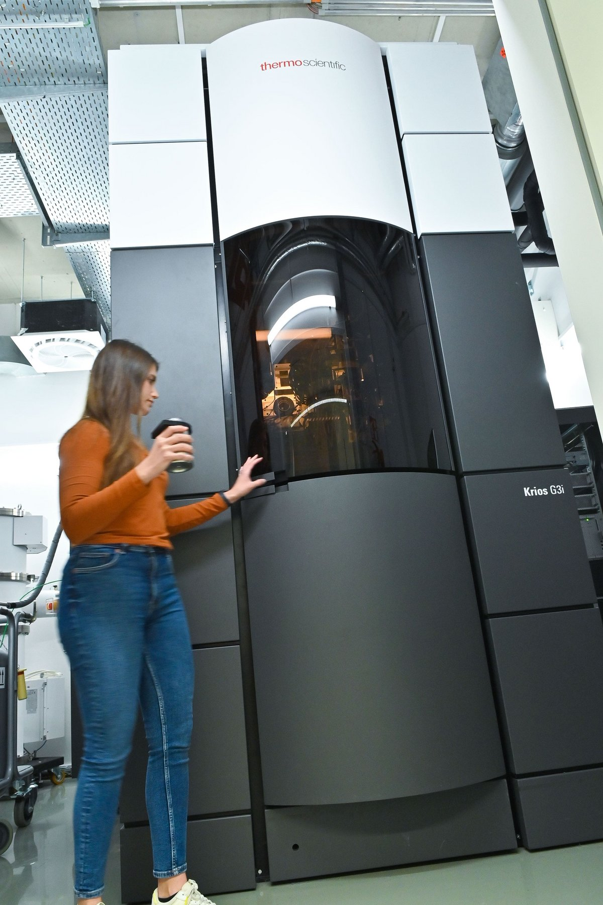{height="350px"}
:::
::::


## k-mer or s-mer ? {.smaller}

**findere** [@robidou2021findere]: index short **s-mers**, query long **k-mers**, with $k = s + z$

::: {.incremental}
- Build: insert every **s-mer** of the sample in the Bloom filter
- Query: a k-mer contains $z + 1$ consecutive s-mers
  - e.g. $s = 3$, $z = 6$: `ATCAATGAT` $\rightarrow$ `ATC`, `TCA`, `CAA`, `AAT`, `ATG`, `TGA`, `GAT`
  - k-mer is [**absent**]{.red} as soon as **one** s-mer is missing (100% sure) 
  - k-mer reported [**present**]{.green} only if **all** s-mers are found (FP rate ?)
- A false positive needs $z + 1$ s-mer false positives in a row
  - roughly $p^{z+1}$: $p = 25\%$, $z = 6$ gives $\approx 0.006\%$
:::
. . .

:::  {style="width: fit-content; margin: 40px auto;"}
➡ Improve precision on smaller filters
:::

::: notes
1.5 min. findere trades a slightly higher false positive rate per s-mer
for a much lower one per k-mer. kmindex builds on s-mers and queries with z.
:::

## kmtricks params

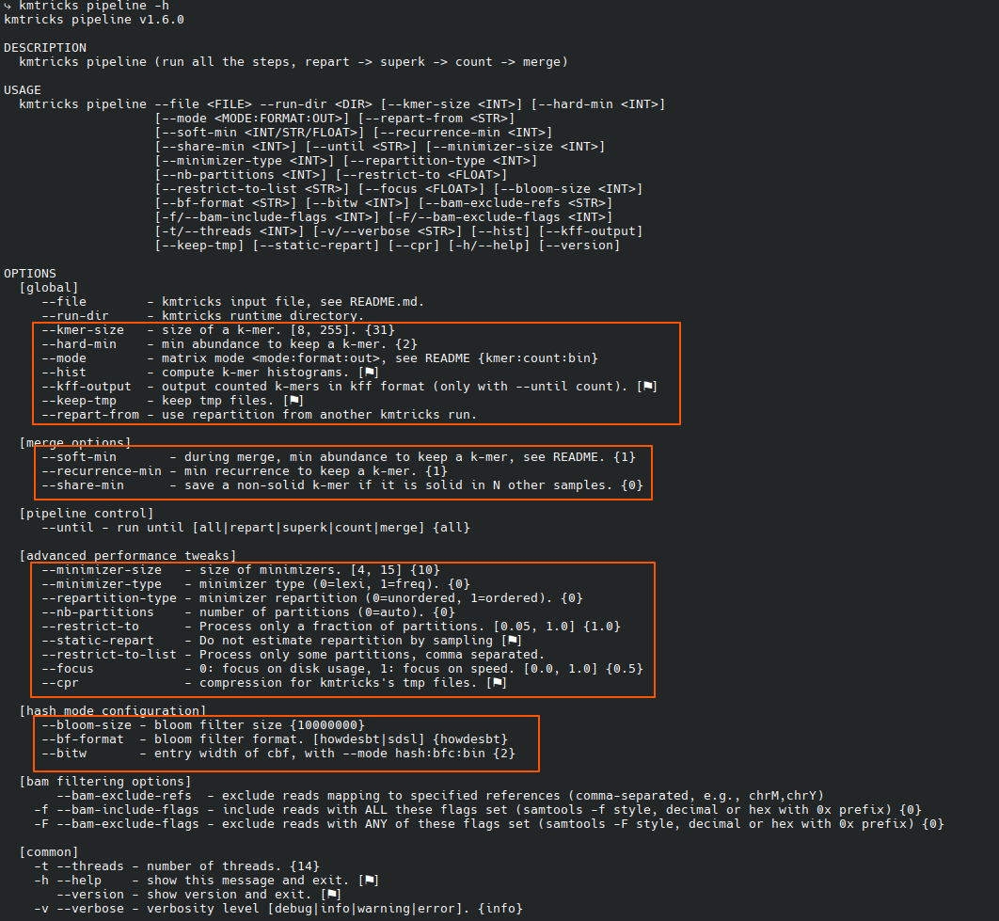{.nostretch fig-align="center" height="500px"}

. . .

::: {style="text-align: center; font-size: 0.8em;"}
➡ How to tune `kmtricks` build parameters ? 
:::

## Building is a chain of decisions

::: {.r-stack}
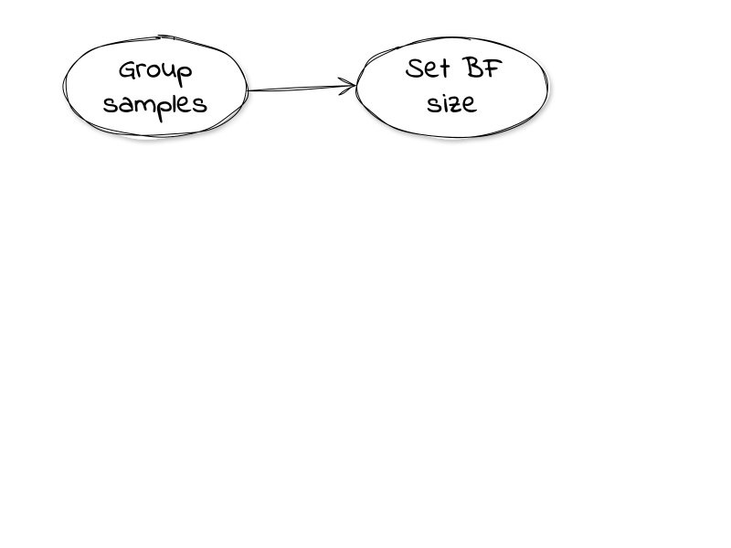{.fragment .fade-out fragment-index=1 height="480px"}

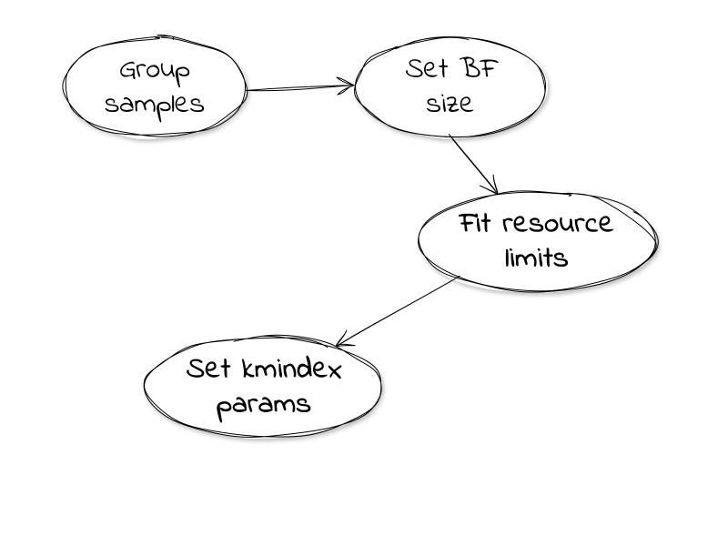{.fragment .fade-in-then-out fragment-index=1 height="480px"}

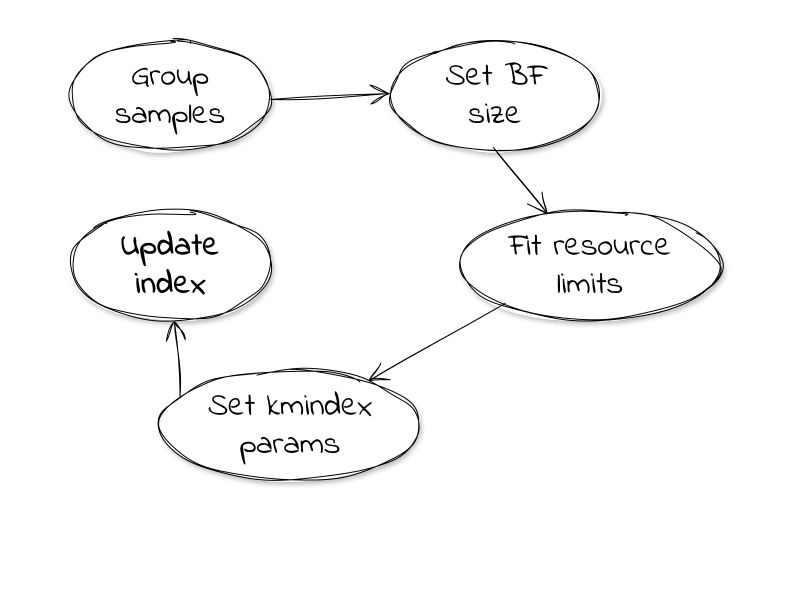{.fragment .fade-in-then-out fragment-index=2 height="480px"}

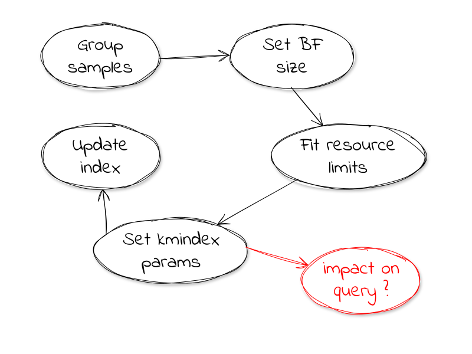{.fragment .fade-in-then-out fragment-index=3 height="480px"}

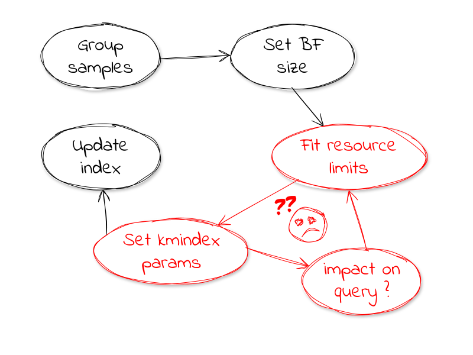{.fragment .fade-in fragment-index=4 height="480px"}
:::

. . .

::: {style="text-align: center; font-size: 0.8em;"}
➡ **kmhelpers automates these decisions**, from raw samples to queries.
:::

::: notes
1.5 min. A wrong choice at any step wastes compute or yields an oversized index.
- size each Bloom filter to the k-mer count of its sample
- tune kmindex internals (false positives rate, minimizers, partitions, ...)
- fit each build in the RAM, disk and open files of the machine
- group samples into sub-indexes: index size vs query speed (cf. Rebecca's work)
- keep the index up to date as new samples arrive
:::

::: {.content-hidden}
All Bloom filters of one size are stored as **one matrix** (one sub-index):
one column per sample, one row per k-mer hash.

| Strategy | Files opened per query | Storage |
|----------|:----------------------:|:-------:|
| One size for all (largest sample) | 1 | very large |
| One sub-index per sample | $n$ (up to millions) | minimal |
| **kmhelpers**: $G$ groups | $G$ | close to minimal |

Sample sizes span several orders of magnitude, so the middle ground matters.
:::

::: notes
1.5 min. The user fixes G, profile picks the Bloom filter size of each group
that minimizes total size.
:::

# kmhelpers {data-state="no-number" data-visibility="uncounted"}

## Index structure {.smaller}

:::: {.columns}
::: {.column width="70%"}
::: {.r-stack}
{.fragment .fade-out fragment-index=1 width="1000px"}

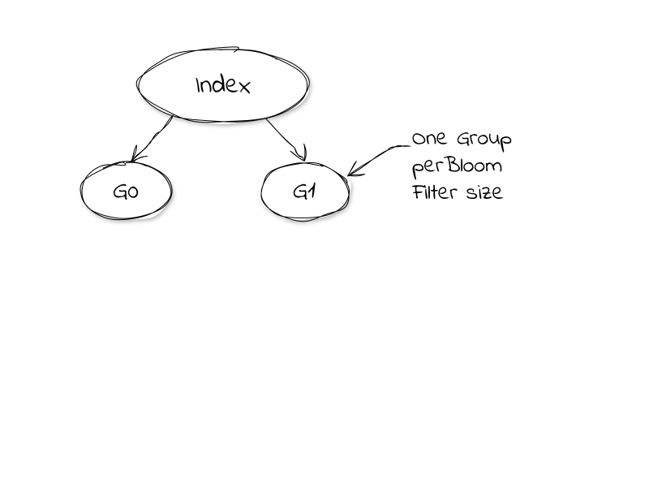{.fragment .fade-in-then-out fragment-index=1 width="1000px"}

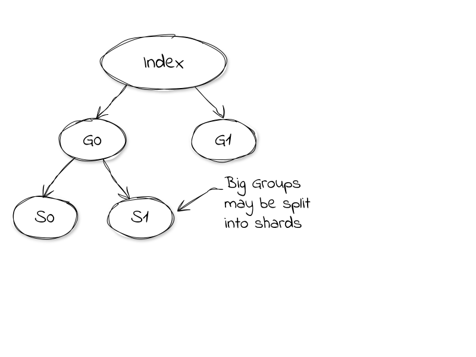{.fragment .fade-in-then-out fragment-index=2 width="1000px"}

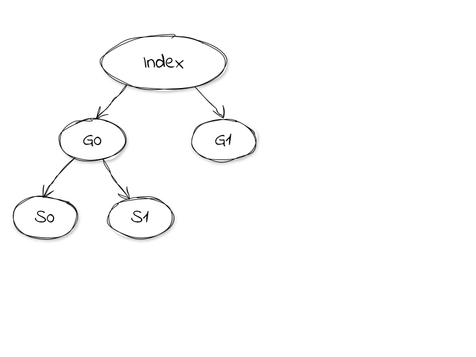{.fragment .fade-in fragment-index=3 width="1000px"}
:::
:::

::: {.column .fragment fragment-index=3 width="30%"}
- We build one sub-index per shard, e.g. `Index_G0_S0`
- All shards in the same group are mergeable

:::

::::

## Pipeline

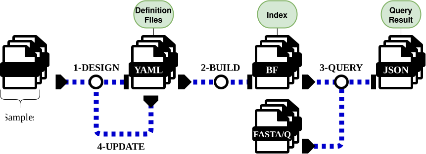{.nostretch fig-align="center" height="500px"}

## Pipeline

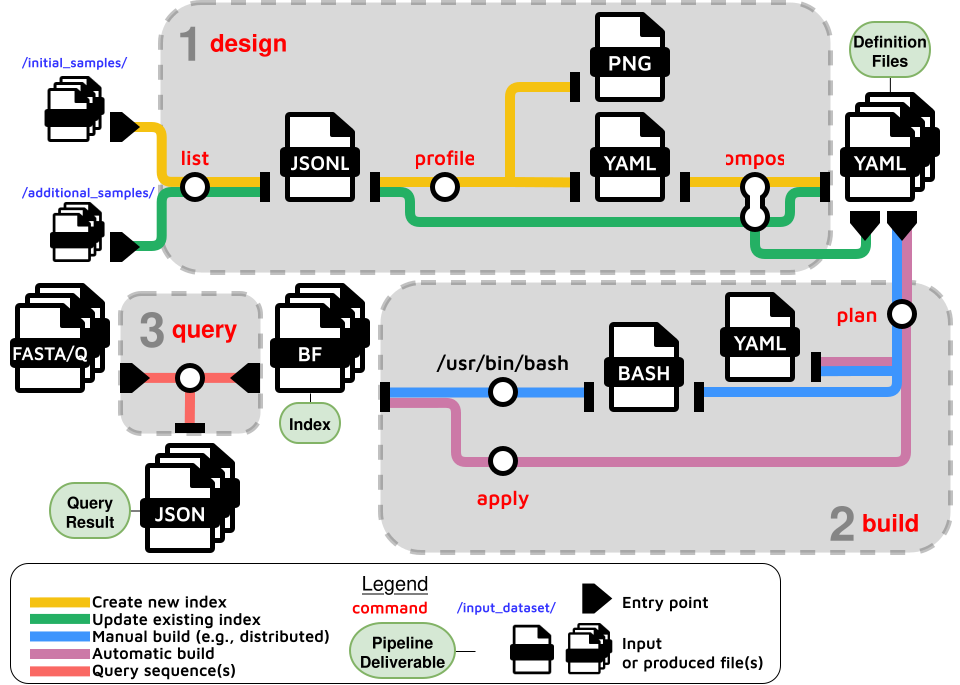{.nostretch fig-align="center" height="600px"}

## Install

WAYS TO INSTALL + LINKS

CLI (`kmhelpers`, alias `kh`) and Python API, Python >= 3.10, GPL-3.0

```bash
pip install kmhelpers && kmhelpers install-deps
conda install -c conda-forge -c bioconda kmhelpers
```

# Workflow {data-state="no-number" data-visibility="uncounted"}


## Super commands

1. Design: list samples, profile them, compose index definitions

. . .

```bash
kmhelpers design /data/sequences -o coli_db/ -n coli
```

Can also be run like:
`list` -> `profile` -> `compose`

2. Build: plan, then apply

. . .

```bash
kmhelpers build coli_db/compose/coli/initial/coli.yaml \
    -o coli_build/
```

Can also be run like: `plan` -> `apply`.

3. Query with FASTA/FASTQ sequences

. . .

```bash
kmhelpers query -r coli_build/ -o results/ query.fa
```
. . .

Each step can also be run on its own:
`list` -> `profile` -> `compose`, then `plan` -> `apply`.

::: notes
1 min. Syntax of the released v0.7.3.
:::

## design 1/3: list, counting k-mers

- Scans a directory (or a file list) and writes a JSONL manifest
- Counts k-mers with **ntCard** [@mohamadi2017], a streaming estimator
- The count drives the Bloom filter size of each sample

| Data type | Mode | Value |
|-----------|------|-------|
| assembled (`-dt assembled`) | DISTINCT | $F_0$ |
| raw reads (`-dt unassembled`) | SOLID | $F_0 - f_1$ |

Singletons in raw reads are mostly sequencing errors.

## design 2/3: profile, spans

A **span** is the size class of a sample: $s = \lfloor \log_{b}(n) \rfloor$,
$n$ its k-mer count, $b$ the base (`-b`, e.g. 1.1).

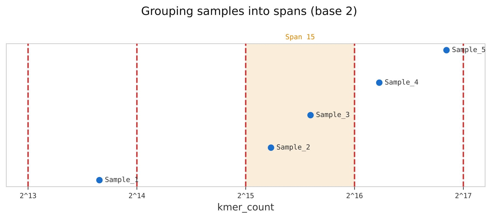{fig-align="center" width="80%"}

Samples of one span share one Bloom filter size.

## design 2/3: profile, groups

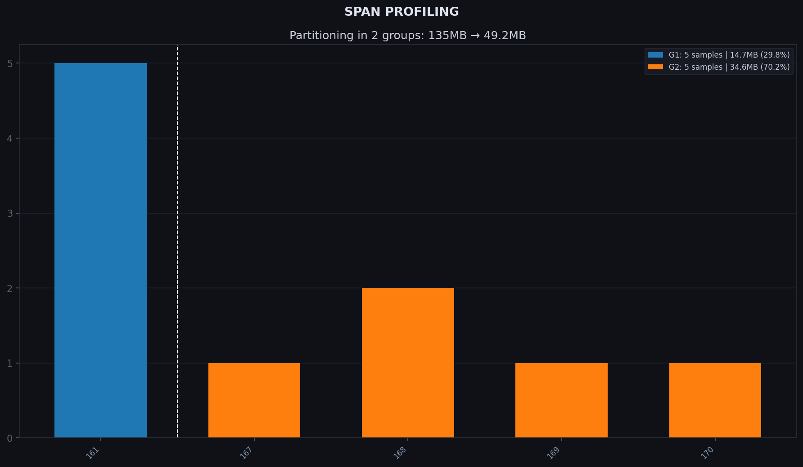{fig-align="center" height="420"}

`-g 2` on 10 *E. coli* assemblies: consecutive spans merged into
2 groups, **135 MB -> 49.2 MB**.

::: notes
1.5 min. profile.yaml and groups.png are written for inspection before building.
:::

## design 3/3: compose

- Assigns each sample to its group and writes the **index definitions**
- Writes a **layout** file: groups, Bloom sizes, partitions, fixed for the
  life of the index
- Each run is a **session** (`-S initial`, `-S update`, ...)
- Optional **sharding** (`--shard-size`): a large group is split into
  independent shards, never merged together

## build: plan, then apply {.smaller}

**plan**

- validates every sample path, disk space and memory upfront
- sizes threads and partitions from resource limits
- writes ready-to-run shell scripts (`--offline` for another machine or testing)

**apply**

- runs kmtricks/kmindex, merges chunks and registers sub-indexes
- filters name, resumes interrupted build

## query

```bash
kmhelpers query -r coli_build/ -o results/ query.fa.gz -z 6
```

- **findere** [@robidou2021findere]: build with FP rate $p = 0.25$,
  query $(k+z)$-mers, effective FP rate $p^z$
  - $0.25^6 \approx 0.024\,\%$, with small Bloom filters
- Inputs: FASTA/FASTQ, gz, bz2, xz, zst, stdin
- Outputs: TSV, JSON, YAML, plus `sequence_stats.tsv`
  and `sample_stats.tsv`
- Markdown or HTML report (`--export`, in development)

## Updating an index

```bash
kmhelpers design new_samples.txt -o coli_db/ -n coli -S update
kmhelpers build coli_db/compose/coli/update/coli.yaml \
    -o coli_build/
```

- The layout is reused: no new profile, existing samples not recounted
- New samples are built, then merged with the current sub-index
- The previous version stays queryable until the swap

## Tuning groups and partitions

- groups: samples split into $G$ sub-indexes
- partitions: each matrix split into $P$ files, by minimizer


## Automation and API

YAML pipelines, with `-x` overrides at run time:

```yaml
- apply:
    workdir: /path/a
    input_files: [a.yaml]
- apply:
    workdir: /path/b
    input_files: [b.yaml]
```

- `kmhelpers pipeline my_pipeline.yaml -x threads 16`
- Global config file (`-C`), environment variables, log file
- Public Python API covering every command

# Use cases {data-state="no-number" data-visibility="uncounted"}

## Tree of Life, Wellcome Sanger Institute

- **Tree of Life, Wellcome Sanger Institute**
  - **Objective**: detect sample swaps (long-read and Hi-C data from different specimens)
  - **~7.5k samples**, raw reads and assemblies mixed
  - index should be updated with new data; shaped the design of [**kmhelpers**]{.blue}


## Logan

- **Logan 1.0** [@logan2024]
  - ~50 petabases of SRA indexed in 2024 
  - Without kmhelpers
  - <https://logan-search.org/>
- **Logan 1.2+**
  - SRA has doubled since
  - Use kmhelpers
  - New home : TACC
  - <https://dev.brc-analytics.org/logan-search>

## Bioswot

# SLURM build (WIP) {data-state="no-number" data-visibility="uncounted"}

## Branches `dev/v0.8.0*`

Goal: run the Logan-scale update on TACC, a SLURM cluster.

- **plan prepares, apply runs**: `plan` takes every decision and writes
  `plan.yaml` plus one script folder per shard
- `apply` only runs these scripts: any of them can run on any node
- **Resume**: complete runs are kept, incomplete
  ones rebuilt

::: notes
1.5 min. Work in progress, not released. About 120 files changed.
:::

## Cluster file

```yaml
type: slurm
partition: compute
time: 2-00:00:00
max_parallel: 8          # array tasks at once
setup: |                 # run before kmhelpers in every job
  export PATH=/path/to/kmhelpers/.env/bin:$PATH
jobs:                    # resources per kind of job
  build:   {cpus: 24, mem: 120G}
  publish: {cpus: 24, mem: 120G}
  check:   {cpus: 1, mem: 4G, time: "1:00:00"}
```

```bash
kmhelpers build coli_db -o coli_build/ --hpc cluster.yaml
```

Chunks are sized from `jobs.build`, merges from `jobs.publish`.

## Workflow

```
TODO FIGURE HERE

build     array, one task per build job (kmtricks chunks)
  |           several nodes at once, at most `max_parallel`
  v
publish   once chunks are built:
  |           check runs, merge, swap in, manage check
  v
finish    after every job (afterany): check registry, send mail...
```

- `submit.sh` only what is not done is submitted (safe to run again)

::: {.content-hidden}
## Features {.smaller}

- `--hpc FILE`: plan, generate the sbatch files, submit, exit
- `--chunks-per-job N`: chunks of a shard grouped into one job
- `apply --status [--sp]`: per shard and step, `SUCCESS`, `FAILED`,
  `RUNNING`, `PENDING`, `LOST` (with the SLURM reason), `CANCELLED`
- `apply --task PATTERN`: live RAM and kmtricks phase of a step
- `apply --cancel`: `scancel` the jobs of the plan
- `--notify EMAIL --notify-level shard`: one mail per shard
- `manage check`: positive and negative queries before publishing
- Stats per run and shard: time, peak RAM and disk, FP rate
:::

## Following a build

```bash
kmhelpers apply coli_db -o coli_build/ --status --sp
```

```yaml
idx_g0:
  idx_g0_initial_chunk0: SUCCESS
  idx_g0_initial_chunk1: FAILED (log: logs/idx_g0/...chunk1.log)
  idx_g0_initial_chunk2: RUNNING (job 18001_2, node12, since 10:02)
  idx_g0_initial_chunk3: PENDING (job 18001_3)
  publish: PENDING (job 18002)
```

Running the same `build` again resubmits only what failed or was lost.

# Nextflow ? {data-state="no-number" data-visibility="uncounted"}

# Conclusion {data-state="no-number" data-visibility="uncounted"}

## Status

- **v0.7.3** PyPI, Bioconda, docs, JOSS paper ([**accepted**]{.green})
- **v0.7.4** abundance indexes, paired reads, automatic group count
- **v0.8.0** (in development)
  - shard and chunk budgets, from Logan
  - SLURM build, being tested on TACC

## Links

- Code: <https://github.com/sebllns/kmhelpers>
- Docs: <https://sebllns.github.io/kmhelpers/>
- Cite: @kmhelpers

Thanks to Téo Lemane (kmindex), Pierre Peterlongo, Kamil S. Jaron,
GenOuest, Inria Challenge OmicFinder, ANR-22-PEAE-0005.

## References {.smaller .scrollable}

::: {#refs}
:::

# {data-state="no-number" data-visibility="uncounted"}

{.nostretch fig-alt="Thank you" fig-align="center" width="60%"}
