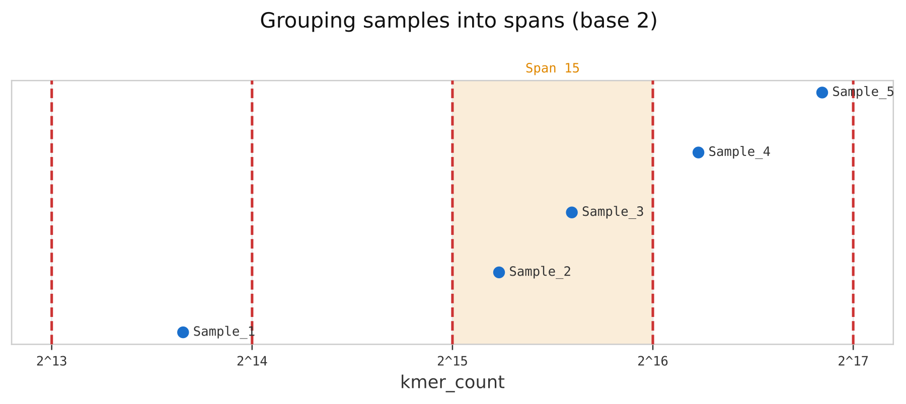
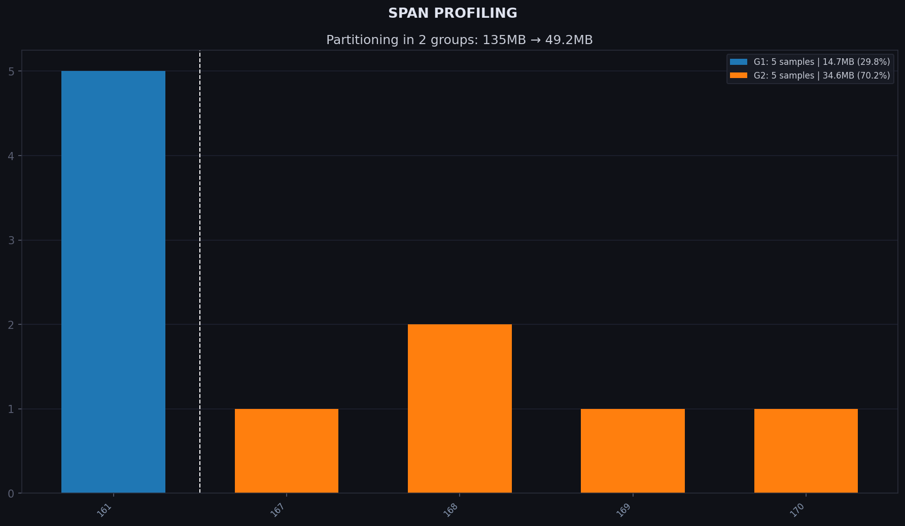

## Super commands {.smaller}

1. Design: list samples, profile them, compose index definitions

. . .

```bash
kmhelpers design /data/sequences -o coli_db/ -n coli
```

Can also be run like:
`list` -> `profile` -> `compose`

2. Build: plan, then apply

. . .

```bash
kmhelpers build coli_db/compose/coli/initial/coli.yaml \
    -o coli_build/
```

Can also be run like: `plan` -> `apply`.

3. Query with FASTA/FASTQ sequences

. . .

```bash
kmhelpers query -r coli_build/ -o results/ query.fa
```

::: notes
1 min. Syntax of the released v0.7.3.
:::

## design 1/3: list, counting k-mers

- Scans a directory (or a file list) and writes a JSONL manifest
- Counts k-mers with **ntCard** [@mohamadi2017], a streaming estimator
- The count drives the Bloom filter size of each sample

| Data type | Mode | Value |
|-----------|------|-------|
| assembled (`-dt assembled`) | DISTINCT | $F_0$ |
| raw reads (`-dt unassembled`) | SOLID | $F_0 - f_1$ |

Singletons in raw reads are mostly sequencing errors.

## design 2/3: profile, spans

A **span** is the size class of a sample: $s = \lfloor \log_{b}(n) \rfloor$,
$n$ its k-mer count, $b$ the base (`-b`, e.g. 1.1).

{fig-align="center" width="80%"}

Samples of one span share one Bloom filter size.

## design 2/3: profile, groups

{fig-align="center" height="420"}

`-g 2` on 10 *E. coli* assemblies: consecutive spans merged into
2 groups, **135 MB -> 49.2 MB**.

::: notes
1.5 min. profile.yaml and groups.png are written for inspection before building.
:::

## design 3/3: compose

- Assigns each sample to its group and writes the **index definitions**
- Writes a **layout** file: groups, Bloom sizes, partitions, fixed for the
  life of the index
- Each run is a **session** (`-S initial`, `-S update`, ...)
- Optional **sharding** (`--shard-size`): a large group is split into
  independent shards, never merged together

## build: plan, then apply {.smaller}

**plan**

- validates every sample path, disk space and memory upfront
- sizes threads and partitions from resource limits
- writes ready-to-run shell scripts (`--offline` for another machine or testing)

**apply**

- runs kmtricks/kmindex, merges chunks and registers sub-indexes
- filters name, resumes interrupted build

## query

```bash
kmhelpers query -r coli_build/ -o results/ query.fa.gz -z 6
```

- **findere** [@robidou2021findere]: build with FP rate $p = 0.25$,
  query $(k+z)$-mers, effective FP rate $p^{z+1}$
  - $0.25^7 \approx 0.006\,\%$ -> smaller Bloom filters, better precision
- Inputs: FASTA/FASTQ, gz, bz2, xz, zst, stdin
- Outputs: TSV, JSON, YAML, plus `sequence_stats.tsv`
  and `sample_stats.tsv`
- Markdown or HTML report (`--export`, in development)

## Updating an index

```bash
kmhelpers design new_samples.txt -o coli_db/ -n coli -S update
kmhelpers build coli_db/compose/coli/update/coli.yaml \
    -o coli_build/
```

- The layout is reused: no new profile, existing samples not recounted
- New samples are built, then merged with the current sub-index
- The previous version stays queryable until the swap
